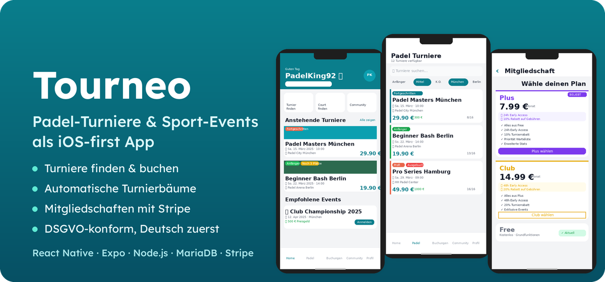

  

  <picture>
    <source media="(prefers-color-scheme: dark)" srcset="assets/typing-dark.svg">
    
  </picture>

### 👋 Über mich

Ich bin Lukas, Full-Stack-Entwickler aus Deutschland.
Ich baue Software vom Datenbankschema bis zur fertigen App und bringe sie selbst in Betrieb: Cloud-Plattformen, Web-Apps, Mobile-Apps und Windows-Dienste.

- 🔭 Gerade dran: **owncloud.online** (Kern, Sicherheit, Releases) und ein **Workspace** für Aufgaben, Wiki und Service Desk
- 📱 Eigenes Projekt: **[Tourneo](https://github.com/GrossLukas/tourneo)** – Padel-Turniere als iOS-App
- 🏢 Weitere Projekte: **[BWTECH-github](https://github.com/BWTECH-github)** und **[BW-Tech-GmbH](https://github.com/BW-Tech-GmbH)**
- 🤝 Gern bei: sauberem Code, durchdachten Oberflächen und Lösungen, die im Alltag wirklich helfen

## ⭐ Tourneo

  

Turniere finden und buchen, Turnierbäume automatisch erzeugen, Teams und Freunde, Mitgliedschaften mit Stripe, Push-Nachrichten – DSGVO-konform und Deutsch zuerst.
**React Native · Expo Router · TypeScript · Zustand · Node.js/Express · Knex · MariaDB · Stripe · Firebase**

## 🧩 Projekte

> Die meisten Repos sind privat (Firmen- und Kundenprojekte). Verlinkt ist, was öffentlich ist.

#### ☁️ Cloud & Plattform

| Projekt | Worum es geht | Stack |
|---|---|---|
| **[owncloud.online](https://github.com/BWTECH-github/owncloud.online)** | Cloud-Plattform für Dateien, Freigaben und Zusammenarbeit – Kern auf PHP 8.4, Sicherheit, Releases und über 30 Apps | PHP · JavaScript |
| **[Desktop-Client](https://github.com/BWTECH-github/client)** | Synchronisation zwischen Server und Rechner – Windows, macOS, Linux | C++ |
| **[iOS-App](https://github.com/BWTECH-github/IOS-App)** · **[Android-App](https://github.com/BWTECH-github/Android)** | Dateien unterwegs ansehen, teilen und hochladen | Swift · Kotlin |
| **Outlook-Add-in** | Dateien direkt aus Outlook teilen | C# |
| **BWTalk** | Chat, Video- und Audiokonferenzen | JavaScript |
| **MCP-Connector** | KI-Assistenten sicher an owncloud.online anbinden | PHP |
| **Kundenportal & Bestellstrecke** | Self-Service für Kunden, Bestellung mit Zahlungsanbindung | Vue · PHP |
| **Manager & Monitoring** | Verwaltung der Instanzen, Überwachung per CheckMK | Python |
| **Marktplatz & Doku** | App-Marktplatz und Dokumentation mit eigenem Backend | PHP · JavaScript |

#### 🌐 Web-Apps

| Projekt | Worum es geht | Stack |
|---|---|---|
| **Workspace** | Aufgaben, Wiki, Service Desk mit Kundenportal, Inventar und IPAM – gemeinsames Bearbeiten in Echtzeit | Next.js · Prisma · Yjs · Tiptap |
| **Online-Terminbuchung** | Buchungssystem für eine Praxis, live im Einsatz | Next.js · Prisma · NextAuth |
| **Angebote & Aufträge** | Angebote schreiben, Aufträge verfolgen | Svelte · SQLite |
| **CRM · Controlling · Verwaltung** | Kunden, Zahlen und Abläufe für kleine Unternehmen | TypeScript · React |
| **Wärmepumpen-Bedarfstool** | Bedarfsanalyse mit passenden Hersteller-Empfehlungen | Blazor |

#### 🪟 Windows & .NET

| Projekt | Worum es geht | Stack |
|---|---|---|
| **MailWorker** | Überwacht Exchange-Postfächer, zieht PDFs heraus, gruppiert und führt sie zusammen | C# · Windows-Dienst |
| **Metadaten-Verarbeiter** | Automatische Dateiannahme, OCR und Metadaten, Ablage mit Protokoll | C# · Windows-Dienst |
| **SignMaster Pro** | Professionelle PDF-Signierung | .NET 8 · WinForms |
| **FileContentSearcher** | Schnelle Volltextsuche in Ordnern mit Live-Treffern | C# · WinForms |
| **XRechnung-Viewer** | E-Rechnungen (XML) als druckbares PDF/HTML | C# |

## 🛠️ Stack

  <picture>
    <source media="(prefers-color-scheme: dark)" srcset="assets/tech-dark.svg">
    
  </picture>

  <a href="https://www.linkedin.com/in/lukas-gross-498a11266">LinkedIn</a> · <a href="https://github.com/GrossLukas/tourneo">Tourneo</a>

