  

  <picture>
    <source media="(prefers-color-scheme: dark)" srcset="assets/typing-dark.svg">
    
  </picture>

  
  

## <samp>~/über-mich</samp>

Ich mag es, Ideen von null bis live selbst umzusetzen: Datenbank, Backend, Web-App, Mobile-App, Server. Alles aus einer Hand.

- Ich baue Webseiten, Web-Apps, Mobile-Apps, Backends und Windows-Tools
- Ich kümmere mich auch um den Betrieb: Server, Deployment, Monitoring
- Ich arbeite jeden Tag mit KI, z. B. mit Claude und Codex, und baue KI auch in eigene Apps ein
- Mir wichtig: sauberer Code, Oberflächen, die Spaß machen, und Lösungen, die wirklich was bringen

## <samp>~/tourneo</samp>

  

Meine eigene App für Padel-Turniere: Turniere finden und buchen, Turnierbäume werden automatisch erstellt, dazu Teams, Freunde, Mitgliedschaften und Push-Nachrichten.
**React Native · Expo Router · TypeScript · Zustand · Node.js/Express · Knex · MariaDB · Firebase**

## <samp>~/side-projects</samp>

Eigene Ideen, an denen ich rumbaue und neue Sachen ausprobiere. Die Repos sind privat – hier steht, was sie können.

<!-- Neues Projekt: 
-Block kopieren und anpassen -->

<b>Team-Workspace</b> – Aufgaben, Wiki und Service Desk in einer App.

<ul>
  <li>Boards, Sprints und Backlog</li>
  <li>Wiki mit Versionen und gemeinsamem Bearbeiten in Echtzeit</li>
  <li>Service Desk mit Mail-Eingang</li>
  <li>Zeiterfassung mit Wochenberichten</li>
  <li>Rechte, Zwei-Faktor und Single Sign-on</li>
</ul>
Next.js · React · Prisma · Tailwind CSS

<b>Terminbuchung &amp; Kalender</b> – Termine online buchen und im Kalender verwalten.

<ul>
  <li>Freie Zeiten in Echtzeit</li>
  <li>Serientermine und Warteliste</li>
  <li>Tages- und Wochenansicht</li>
  <li>Zwei-Faktor und Zugriffsprotokoll</li>
</ul>
Next.js · React · Prisma · Tailwind CSS

<b>CRM mit Echtzeit-Chat</b> – Kontakte, Deals und Termine an einem Ort.

<ul>
  <li>Deals im Kanban-Board</li>
  <li>Kalender mit Einladungen und ICS-Feed</li>
  <li>Chat in Echtzeit mit Kanälen</li>
  <li>Push-Benachrichtigungen</li>
</ul>
Node.js · Express · React · Socket.IO

<b>Finanz-Dashboard</b> – Aus Buchhaltungsexporten nachvollziehbare Auswertungen machen.

<ul>
  <li>Exporte einlesen und zuordnen</li>
  <li>Budget, Forecast und Szenarien</li>
  <li>Liquiditätsplanung über 13 Wochen</li>
  <li>Jede Kennzahl bis zur Einzelbuchung nachvollziehbar</li>
</ul>
TypeScript · React · Fastify · Zod

<b>Angebote &amp; Wiedervorlagen</b> – Offene Angebote im Blick behalten und rechtzeitig nachfassen.

<ul>
  <li>PDF einlesen, Daten werden vorgeschlagen</li>
  <li>Automatische Wiedervorlagen</li>
  <li>Board mit Drag &amp; Drop und Volltextsuche</li>
  <li>Monatsauswertung</li>
</ul>
SvelteKit · Svelte 5 · TypeScript · SQLite

<b>Aufgabenboard</b> – Schlankes Board, um Aufgaben zu planen und Zeiten zu erfassen.

<ul>
  <li>Drag &amp; Drop über vier Spalten</li>
  <li>Bilder per Einfügen</li>
  <li>Kommentare und Änderungsverlauf</li>
  <li>Zeiterfassung mit CSV-Export</li>
</ul>
Next.js · React · Prisma · Tailwind CSS

<b>Kursplanungs-App</b> – Kurse, Absagen und Vertretungen in einer Mobile App.

<ul>
  <li>Kursplan über mehrere Standorte</li>
  <li>Absagen mit Push-Nachricht</li>
  <li>Vertretung per Tipp übernehmen</li>
  <li>Auswertung mit CSV-Export</li>
</ul>
React Native · Expo · Supabase

<b>Bedarfsrechner</b> – Per Fragebogen das passende Gerät finden.

<ul>
  <li>Geführter Fragebogen</li>
  <li>Rangliste nach gewichteten Kriterien</li>
  <li>Technische Daten im Vergleich</li>
  <li>Anmeldung per Single Sign-on</li>
</ul>
C# · .NET 8 · Blazor

## <samp>~/weitere-projekte</samp>

#### Cloud & Plattform

| Projekt | Worum es geht | Stack |
|---|---|---|
| **Cloud-Plattform** | Dateien speichern, teilen und gemeinsam bearbeiten | PHP · JavaScript |
| **Sync-Client** | Dateien zwischen Server und Rechner synchron halten | C++ |
| **Mobile Apps** | Dateien unterwegs ansehen, teilen und hochladen | Swift · Kotlin |
| **Outlook-Add-in** | Dateien direkt aus Outlook teilen | C# |
| **Konferenz-App** | Chat, Video- und Audiokonferenzen | JavaScript |
| **KI-Schnittstelle** | KI-Assistenten an die Cloud anbinden | PHP |
| **Kundenportal** | Self-Service und Bestellung für Kunden | Vue · PHP |
| **Instanz-Verwaltung** | Instanzen verwalten und überwachen | Python |
| **App-Marktplatz & Doku** | App-Marktplatz und Dokumentation | PHP · JavaScript |

#### Windows & .NET

| Projekt | Worum es geht | Stack |
|---|---|---|
| **Postfach-Automatisierung** | PDFs aus Postfächern automatisch einsammeln und zusammenführen | C# · Windows-Dienst |
| **Dokumenten-Verarbeitung** | Dateien annehmen, auslesen und ablegen | C# · Windows-Dienst |
| **PDF-Signatur** | PDF-Dokumente signieren | .NET 8 · WinForms |
| **Volltextsuche** | Schnelle Volltextsuche in Ordnern | C# · WinForms |
| **E-Rechnungs-Viewer** | E-Rechnungen lesbar machen | C# |

## <samp>~/stack</samp>

  <picture>
    <source media="(prefers-color-scheme: dark)" srcset="assets/tech-dark.svg">
    
  </picture>

  <a href="https://www.linkedin.com/in/lukas-gross-498a11266">LinkedIn</a> · <a href="https://github.com/GrossLukas/tourneo">Tourneo</a>

